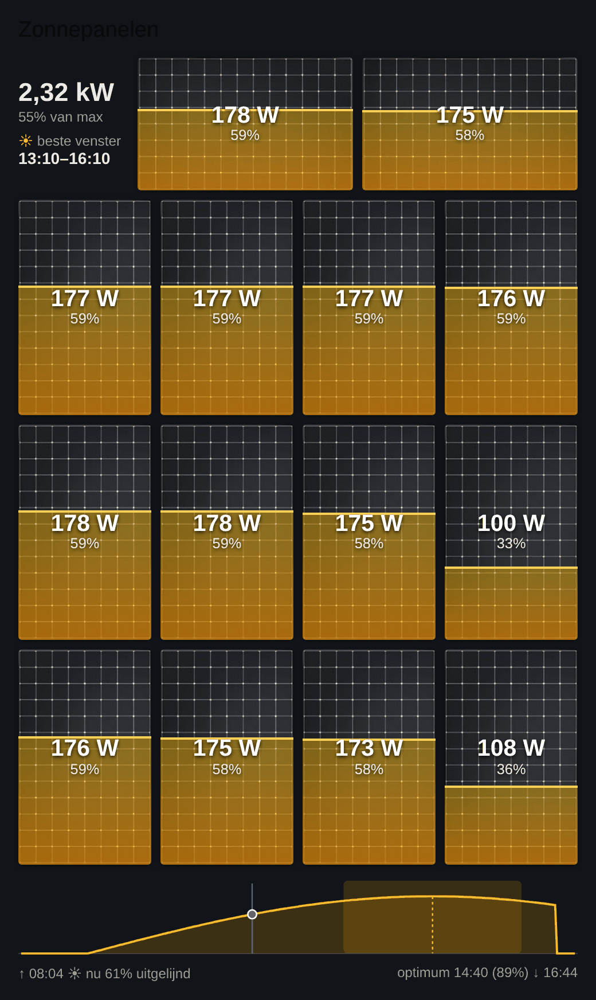

# Solar Roof Card

A Lovelace card for Home Assistant that draws your solar roof as a map of panels. Every panel shows its own power in W and fills up from the bottom to show how close it is to its maximum. The free corner of the roof shows the total power, the percentage of the system maximum and the optimum moment (or optimum window) of the day, calculated from your roof pitch and compass bearing.



## Features

- Roof map: a top row of landscape panels aligned to the right, with rows of portrait panels below (default 2 + 3 × 4 = 14 panels).
- Per panel: power in W, percentage of the panel maximum and a fill from the bottom. Tap a panel to open its more-info dialog.
- Info block in the free top-left corner: total power, % of maximum and the optimum.
- Optimum based on geometry: the card calculates the sun position for your Home Assistant location and the angle between the sun and the panel normal (from roof pitch and bearing).
  - With `optimal_window` set, it shows the start and end time of the best window of that length.
  - Without it, it shows the optimum time.
  - The time turns orange while you are in the optimum.
- Optional day curve: how well the sun lines up with the panels from sunrise to sunset, with the window, the optimum and a marker for now.
- Visual editor.
- Works with any per-panel power sensors, for example the Enphase Envoy micro-inverter sensors.

## Installation

1. Copy `solar-roof-card.js` to `/config/www/`.
2. Settings → Dashboards → ⋮ → Resources → add `/local/solar-roof-card.js` as a JavaScript module.
3. Reload your browser.

## Configuration

```yaml
type: custom:solar-roof-card
title: Solar panels
roof_pitch: 51          # roof pitch relative to the horizon, in degrees
azimuth: 225            # compass bearing the panels face (180 = south, 225 = south-west)
optimal_window: 180     # minutes; leave out to show only the optimum time
panel_max: 300
total_entity: sensor.envoy_current_power_production
panels:                 # top row left -> right, then each row left -> right
  - sensor.inverter_1
  - sensor.inverter_2
  # ...
```

| Option | Default | Description |
| --- | --- | --- |
| `panels` | required | Power sensors (W or kW), one per panel, top row first, left to right |
| `title` | – | Card title |
| `roof_pitch` | `35` | Roof pitch relative to the horizon (°) |
| `azimuth` | `180` | Compass bearing of the panels (°, 0 = north, 90 = east) |
| `optimal_window` | – | Length of the optimum window in minutes; without it the optimum time is shown |
| `panel_max` | `300` | Maximum power of one panel (W), used for the fill |
| `max_power` | panels × `panel_max` | Maximum of the whole system (W), used for the total % |
| `total_entity` | sum of panels | Sensor with the total power |
| `top_row` | `2` | Number of landscape panels in the top row |
| `columns` | `4` | Number of portrait panels per row |
| `show_timeline` | `true` | Show the day curve |
| `latitude` / `longitude` | Home Assistant location | Override the location |

## Notes

- The optimum is purely geometric: it is the moment the sun is most perpendicular to the panels. Shade from buildings or trees is not taken into account.
- The panel normal points at elevation `90 − roof_pitch` in the direction of `azimuth`; alignment is the cosine of the angle between that normal and the sun.
- Labels are in Dutch.

## License

MIT
